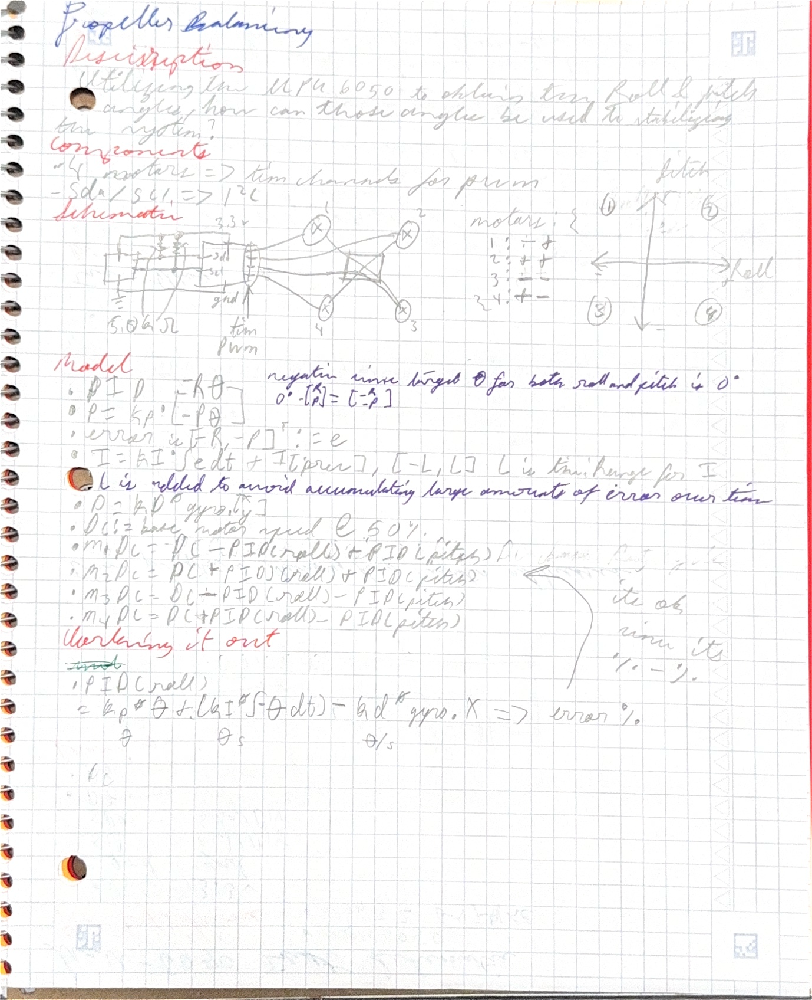

<b><u>The Basis of the PID implementation</u></b>

*Premise*

The goal of the PID is to tell each pwm channel it's target duty cycle it needs to be at to correct the entire system. 
The error of the PID will be defined as just {-roll, -pitch} since the target roll and pitch angles are 0 degrees respectively; therefore, it is simply

`error: 0 - {roll, pitch} = {-roll, -pitch}`

From this the PID can be defined as such:

